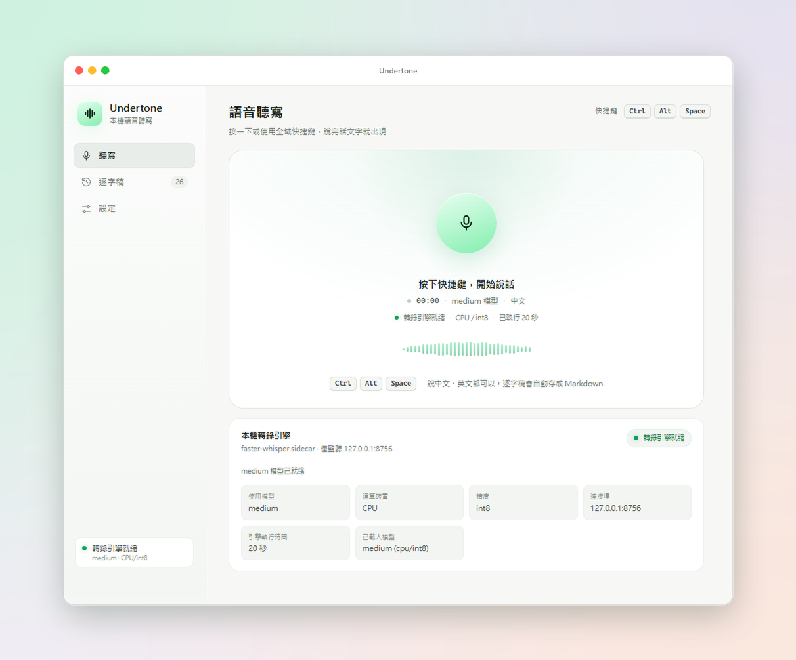

<p align="center">
  
</p>

<h1 align="center">Undertone</h1>

<p align="center">
  <b>本機優先的語音聽寫</b> · 按一下快捷鍵，說完話，文字直接出現在你正在使用的程式裡。<br />
  <a href="#繁體中文">繁體中文</a> · <a href="#english">English</a>
</p>

<p align="center">
  
</p>

---

## 繁體中文

<p align="center">
  <b>繁體中文</b> · <a href="#english">English</a>
</p>

受 [Epicenter](https://epicenter.so/) 的 Whispering 啟發：沒有帳號、沒有訂閱、音訊不上傳，
逐字稿就是你磁碟上的一份純文字 Markdown。

### 功能

- **全域快捷鍵聽寫** — 預設 `Ctrl + Alt + Space`，在任何程式裡按一下開始、再按一下結束。
- **完全離線** — 使用 [faster-whisper](https://github.com/SYSTRAN/faster-whisper)；模型下載後不需要網路。
- **自動貼上** — 轉錄完成後直接把文字貼到游標位置，同時保留在剪貼簿。
- **純文字工作區** — 逐字稿存成 Markdown，可用 Obsidian、VS Code、grep、Git。
- **系統匣常駐** — 關閉視窗後仍在背景待命，從系統匣開啟或直接按快捷鍵。
- **亮色／暗色介面** — 預設跟隨系統，也可以在設定裡固定成亮色或暗色。
- **模型與裝置可切換** — tiny → large-v3，CPU / NVIDIA GPU。
- **繁體中文優先** — 預設提示詞會引導 Whisper 輸出繁體中文與標點。

### 架構

```
┌────────────────────────────┐
│ React UI (Vite)            │  主視窗 + 錄音時的浮動小視窗
└──────────────▲─────────────┘
               │ Tauri IPC / events
┌──────────────┴─────────────┐
│ Rust (Tauri 2)             │  全域快捷鍵、麥克風錄音 (cpal)、
│                            │  剪貼簿與模擬貼上 (enigo)、逐字稿存檔
└──────────────▲─────────────┘
               │ HTTP 127.0.0.1:8756
┌──────────────┴─────────────┐
│ Python sidecar             │  faster-whisper / CTranslate2
│ (只監聽 loopback)           │  模型快取、VAD、轉錄
└────────────────────────────┘
```

### 系統需求

**使用安裝檔**

| 需求 | 說明 |
| --- | --- |
| Windows 10/11（64-bit） | 使用 WASAPI 擷取麥克風 |
| WebView2 | Windows 11 內建；安裝程式會在缺少時自動下載 |
| 網路（僅第一次） | 下載 Whisper 模型後即可完全離線 |
| NVIDIA GPU（選填） | 想用 CUDA 加速時需要 CUDA 12 + cuDNN 9，缺少時自動使用 CPU |

安裝檔已內含 Python 引擎，**不需要安裝 Python、Node.js 或任何 pip 套件**。

**從原始碼建置**

| 需求 | 說明 |
| --- | --- |
| Windows 10/11 | 使用 WASAPI 擷取麥克風 |
| Node.js 20+ | 建置前端 |
| Rust (MSVC toolchain) | 建置 Tauri 後端 |
| Python 3.10–3.12 | 執行 faster-whisper（建議 3.11） |
| WebView2 | Windows 11 內建；Windows 10 可能需要安裝 |
| NVIDIA GPU（選填） | 想用 CUDA 加速時需要 CUDA 12 + cuDNN 9 |

> 不需要 ffmpeg：sidecar 以 PyAV 解碼音訊。

### 下載安裝檔

到 [Releases](../../releases) 下載最新的 `Undertone_x.y.z_x64-setup.exe`，直接執行即可。
安裝程式是 per-user 安裝（不需要管理員權限），完成後從開始功能表開啟 Undertone。

- 安裝檔已內含轉錄引擎，**不需要另外安裝 Python**。
- 第一次啟動會從 Hugging Face 下載 `small` 模型（約 480 MB），之後完全離線。
- 安裝檔未做程式碼簽章，Windows SmartScreen 可能顯示「Windows 已保護您的電腦」；
  點「更多資訊 → 仍要執行」即可。

### 快速開始（從原始碼）

```powershell
# 1. 安裝前端依賴
npm install

# 2. 建立 Python 虛擬環境、安裝 faster-whisper、預先下載 small 模型
powershell -ExecutionPolicy Bypass -File scripts/setup.ps1

# 3. 啟動應用程式
npm run app
```

第一次啟動時，側邊欄會顯示「載入模型」，完成後變成「轉錄引擎就緒」。
之後按 `Ctrl + Alt + Space` 就能在任何地方聽寫。

#### 只想換一顆模型？

```powershell
powershell -ExecutionPolicy Bypass -File scripts/setup.ps1 -Model medium
```

或在 App 的「設定 → 轉錄模型」切換，第一次切換會自動下載。

### 使用方式

1. 在任意程式（Word、瀏覽器、VS Code…）把游標放到想輸入的位置。
2. 按 `Ctrl + Alt + Space`，畫面下方會出現浮動的「聆聽中」提示。
3. 說話。再按一次快捷鍵結束。
4. 幾秒後文字會自動貼上，並同步存成逐字稿。

也可以在 Undertone 視窗按麥克風按鈕操作。若不想自動貼上，可在設定關閉「自動貼上」，
文字仍會保留在剪貼簿。

關閉主視窗時 Undertone 會縮到系統匣（托盤），按快捷鍵仍可聽寫；要完全結束請從系統匣選單
選擇「結束」。

### 資料放在哪裡

| 內容 | 路徑 |
| --- | --- |
| 逐字稿 | `%USERPROFILE%\Undertone\transcripts\YYYY-MM-DD\HHMMSS.md` |
| 設定 | `%APPDATA%\so.undertone.app\settings.json` |
| 模型快取 | `%APPDATA%\so.undertone.app\models\` |
| 引擎日誌 | App 內「設定 → 引擎日誌」 |

逐字稿格式：

```markdown
---
created: 2026-11-03T15:04:05+08:00
model: small
language: zh
duration: 6.4
---

今天天氣很好，我們一起來測試語音轉文字功能。
```

工作區路徑可以改到 Dropbox、OneDrive 或任何 Git repo，資料夾結構不會被鎖在 App 裡。

### 模型選擇

| 模型 | 下載大小 | 速度 | 建議情境 |
| --- | --- | --- | --- |
| tiny | ~75 MB | 最快 | 即時短句、低階硬體 |
| base | ~145 MB | 快 | 快速筆記 |
| **small** | ~480 MB | 平衡 | **預設，多數情況夠用** |
| medium | ~1.5 GB | 較慢 | 追求準確度 |
| large-v3 | ~3 GB | 最慢 | GPU 使用者、長段落 |
| distil-large-v3 | ~1.5 GB | 快 | 英文為主 |

CPU 上 `small + int8` 通常能接近即時；有 NVIDIA GPU 時可在設定把裝置改為 `cuda`，
精度選 `float16`，速度會明顯提升。若 CUDA 環境不完整，引擎會自動退回 CPU。

在「設定 → 語言與運算」可設定 **GPU 閒置自動釋放**（預設 10 分鐘）。連續閒置超過指定時間後，
引擎會卸載 CUDA 模型以釋放顯存並預載 CPU 模型；下一次聽寫會先以 CPU 完成，接著在背景把 GPU
模型載回來，之後的聽寫自動恢復 GPU。設為 0 可停用。

Windows 上想啟用 CUDA，除了顯卡驅動還需要 cuBLAS 12 與 cuDNN 9。最簡單的方式是用 pip 安裝：

```powershell
sidecar\.venv\Scripts\python.exe -m pip install nvidia-cublas-cu12 nvidia-cudnn-cu12 nvidia-cuda-runtime-cu12 nvidia-cuda-nvrtc-cu12
```

sidecar 啟動時會自動把這些套件裡的 DLL 加入搜尋路徑（`scripts/setup.ps1` 在偵測到 NVIDIA GPU 時會自動安裝）。缺少時會自動退回 CPU，不影響使用。注意：安裝版內含的引擎預設是 CPU 版，想在安裝版用 GPU 請先裝好上面四個套件再跑 `npm run installer` 重新打包。

### 打包成安裝檔

```powershell
# 一行完成：PyInstaller 打包引擎 → Tauri 建置 NSIS 安裝檔
npm run installer
```

等於：

```powershell
powershell -ExecutionPolicy Bypass -File scripts/build-sidecar.ps1
npm run tauri build -- --config src-tauri/tauri.installer.conf.json
```

輸出會放在 `src-tauri/target/release/bundle/nsis/`。

引擎 exe 只在 `src-tauri/tauri.installer.conf.json` 裡被加進 `bundle.resources`，
會落到安裝檔的 `resources/sidecar/`。安裝版沒有原始碼目錄，`sidecar.rs` 會使用它，
所以使用者端不需要 Python；從原始碼執行時則優先使用 `sidecar/.venv`，
避免 `target/debug` 裡殘留的舊 exe 蓋掉開發環境。平常的 `tauri.conf.json`
刻意不引用它，這樣 `cargo check` 與 `npm run app` 不需要先打包引擎。

> PyInstaller 打包 ctranslate2 / onnxruntime / PyAV 需要較長時間，產物約 200–300 MB。
> 若打包後的 sidecar 缺少 DLL，先單獨執行 `sidecar\dist\undertone-sidecar.exe --port 8757`
> 看缺哪個檔案，再把對應套件加進 `--collect-all` 清單。
>
> 開發模式（`npm run app`）會直接使用 `sidecar\.venv\Scripts\python.exe`，不需要先打包。

#### 發佈流程

推送 `v*` 標籤後，GitHub Actions（`.github/workflows/release.yml`）會自動在
`windows-latest` 上建置並把安裝檔附到 Release：

```powershell
git tag v0.1.0
git push origin v0.1.0
```

也可以在 Actions 頁面手動執行 workflow，只會產生 artifact，不會建立 Release。

### 疑難排解

**快捷鍵沒反應**
可能被其他程式占用。到「設定 → 全域快捷鍵」重新錄製一組，例如 `Ctrl + Shift + Space`。

**顯示「轉錄引擎未啟動」**
先看「設定 → 引擎日誌」。安裝版最常見原因是第一次啟動時沒有網路（模型下載失敗），
或防火牆擋住 `127.0.0.1`；從原始碼執行則通常是還沒跑 `scripts/setup.ps1`，
或 Python 版本不在 3.10–3.12。

**安裝版第一次啟動特別久**
安裝檔內的引擎是單一 exe，啟動時會先解壓到暫存資料夾（約 10–20 秒），
再加上第一次要下載模型。之後啟動會快很多。

**有畫面但沒有聲音**
到「設定 → 麥克風」確認裝置；Windows 的「隱私權 → 麥克風」也要允許桌面應用程式存取。

**轉錄很慢**
改用 `small` 或 `base` 模型、把裝置設為 CPU + int8，或安裝 CUDA / cuDNN 後切到 GPU。

**貼上到錯的地方**
Undertone 會貼到「目前取得焦點的視窗」。錄音期間請不要切換視窗；也可以關閉自動貼上，
改用剪貼簿手動貼。

### 隱私

- 音訊只經過 `127.0.0.1`，不會離開這台電腦。
- 唯一的網路行為是第一次下載模型（Hugging Face）。
- 沒有帳號、沒有遙測、沒有雲端同步。

### 專案結構

```
src/                 React UI（主視窗 + overlay）
src-tauri/src/       Rust：audio / sidecar / transcripts / paste / settings
sidecar/             Python faster-whisper HTTP 服務
scripts/             setup.ps1 / build-sidecar.ps1 / make-icon.ps1
.github/workflows/   release.yml：推送 v* 標籤時建置並發佈安裝檔
```

### 授權

本專案程式碼採用 [MIT](LICENSE)。安裝檔內含的第三方元件與其授權整理在
[THIRD-PARTY-NOTICES.md](THIRD-PARTY-NOTICES.md)。faster-whisper、Whisper 模型與
Tauri 各自遵循其原始授權。

---

## English

<p align="center">
  <a href="#繁體中文">繁體中文</a> · <b>English</b>
</p>

Inspired by Whispering from [Epicenter](https://epicenter.so/): no account, no subscription,
and audio never leaves your machine. Every transcript is just a plain Markdown file on disk.

### Features

- **Global hotkey dictation** — `Ctrl + Alt + Space` by default; press once to start, again to stop, in any app.
- **Fully offline** — powered by [faster-whisper](https://github.com/SYSTRAN/faster-whisper); once the model is downloaded, no network is needed.
- **Auto paste** — the transcript is typed at your cursor as soon as it is ready, and stays on the clipboard.
- **Plain-text workspace** — transcripts are Markdown files you can open with Obsidian, VS Code, grep, or Git.
- **Lives in the tray** — closing the window keeps it running in the background; reopen it from the tray or just use the hotkey.
- **Light and dark interface** — follows Windows by default, or pin it to light or dark in settings.
- **Switchable model and device** — tiny → large-v3, CPU or NVIDIA GPU.
- **Traditional Chinese first** — the default prompt steers Whisper toward Traditional Chinese with punctuation.

### Architecture

```
┌────────────────────────────┐
│ React UI (Vite)            │  main window + floating recorder overlay
└──────────────▲─────────────┘
               │ Tauri IPC / events
┌──────────────┴─────────────┐
│ Rust (Tauri 2)             │  global hotkey, microphone capture (cpal),
│                            │  clipboard and synthetic paste (enigo), transcripts
└──────────────▲─────────────┘
               │ HTTP 127.0.0.1:8756
┌──────────────┴─────────────┐
│ Python sidecar             │  faster-whisper / CTranslate2
│ (loopback only)            │  model cache, VAD, transcription
└────────────────────────────┘
```

### Requirements

**Using the installer**

| Requirement | Notes |
| --- | --- |
| Windows 10/11 (64-bit) | Microphone capture via WASAPI |
| WebView2 | Bundled with Windows 11; the installer downloads it when missing |
| Network (first run only) | Needed to download the Whisper model; fully offline afterwards |
| NVIDIA GPU (optional) | CUDA 12 + cuDNN 9 for GPU acceleration; falls back to CPU when missing |

The installer ships with the Python engine, so **no Python, Node.js, or pip packages are required**.

**Building from source**

| Requirement | Notes |
| --- | --- |
| Windows 10/11 | Microphone capture via WASAPI |
| Node.js 20+ | Builds the frontend |
| Rust (MSVC toolchain) | Builds the Tauri backend |
| Python 3.10–3.12 | Runs faster-whisper (3.11 recommended) |
| WebView2 | Bundled with Windows 11; may need installing on Windows 10 |
| NVIDIA GPU (optional) | CUDA 12 + cuDNN 9 for GPU acceleration |

> ffmpeg is not required: the sidecar decodes audio with PyAV.

### Download

Grab the latest `Undertone_x.y.z_x64-setup.exe` from [Releases](../../releases) and run it.
It is a per-user install (no admin rights needed); launch Undertone from the Start menu afterwards.

- The installer includes the transcription engine, so **you do not need Python**.
- On first launch it downloads the `small` model from Hugging Face (~480 MB), then works offline.
- The installer is not code-signed, so Windows SmartScreen may show “Windows protected your PC”.
  Click “More info → Run anyway”.

### Quick start (from source)

```powershell
# 1. Install frontend dependencies
npm install

# 2. Create the Python venv, install faster-whisper, pre-download the small model
powershell -ExecutionPolicy Bypass -File scripts/setup.ps1

# 3. Run the app
npm run app
```

On first launch the sidebar shows “載入模型” (loading model) and then “轉錄引擎就緒” (engine ready).
After that, press `Ctrl + Alt + Space` anywhere to dictate.

#### Only want a different model?

```powershell
powershell -ExecutionPolicy Bypass -File scripts/setup.ps1 -Model medium
```

Or switch it in the app under “設定 → 轉錄模型”; the first switch downloads the model automatically.

### Usage

1. Put the cursor where you want the text in any app (Word, a browser, VS Code…).
2. Press `Ctrl + Alt + Space`; a floating “listening” pill appears at the bottom of the screen.
3. Speak, then press the hotkey again to stop.
4. A few seconds later the text is pasted for you and saved as a transcript.

You can also use the microphone button in the Undertone window. If you would rather not auto-paste,
turn off “自動貼上” in settings — the text still stays on the clipboard.

Closing the main window sends Undertone to the tray, and the hotkey keeps working. To quit fully,
choose “結束” from the tray menu.

### Where the data lives

| Item | Path |
| --- | --- |
| Transcripts | `%USERPROFILE%\Undertone\transcripts\YYYY-MM-DD\HHMMSS.md` |
| Settings | `%APPDATA%\so.undertone.app\settings.json` |
| Model cache | `%APPDATA%\so.undertone.app\models\` |
| Engine log | In-app “設定 → 引擎日誌” |

Transcript format:

```markdown
---
created: 2026-11-03T15:04:05+08:00
model: small
language: zh
duration: 6.4
---

今天天氣很好，我們一起來測試語音轉文字功能。
```

The workspace path can point at Dropbox, OneDrive, or any Git repository — the folder layout
is not locked inside the app.

### Choosing a model

| Model | Download | Speed | Best for |
| --- | --- | --- | --- |
| tiny | ~75 MB | Fastest | Snappy one-liners, low-end hardware |
| base | ~145 MB | Fast | Quick notes |
| **small** | ~480 MB | Balanced | **Default; good enough for most cases** |
| medium | ~1.5 GB | Slower | Higher accuracy |
| large-v3 | ~3 GB | Slowest | GPU users, long paragraphs |
| distil-large-v3 | ~1.5 GB | Fast | Mostly English |

On CPU, `small + int8` usually runs close to real time. With an NVIDIA GPU, set the device to
`cuda` and the compute type to `float16` in settings for a big speed-up. If the CUDA environment
is incomplete, the engine falls back to CPU automatically.

Under “Settings → Language & compute” you can set **GPU idle release** (default 10 minutes).
After that much idle time the engine unloads the CUDA model to free VRAM and preloads a CPU
model; the next dictation is answered on CPU while the GPU model reloads in the background,
and later dictations use the GPU again. Set it to 0 to disable.

To enable CUDA on Windows you need cuBLAS 12 and cuDNN 9 on top of the display driver. The easiest
way is pip:

```powershell
sidecar\.venv\Scripts\python.exe -m pip install nvidia-cublas-cu12 nvidia-cudnn-cu12 nvidia-cuda-runtime-cu12 nvidia-cuda-nvrtc-cu12
```

The sidecar adds those packages' DLLs to its search path on startup (`scripts/setup.ps1`
installs them automatically when an NVIDIA GPU is detected). If they are missing it falls
back to CPU; nothing breaks. Note: the bundled engine in the installer is a CPU build by
default; to get GPU in the installed app, install the four packages above first and then
re-run `npm run installer`.

### Building the installer

```powershell
# One command: PyInstaller bundles the engine → Tauri builds the NSIS installer
npm run installer
```

Which is equivalent to:

```powershell
powershell -ExecutionPolicy Bypass -File scripts/build-sidecar.ps1
npm run tauri build -- --config src-tauri/tauri.installer.conf.json
```

The output lands in `src-tauri/target/release/bundle/nsis/`.

The engine exe is only added to `bundle.resources` by `src-tauri/tauri.installer.conf.json`, which
places it under `resources/sidecar/` inside the installer. Installed builds have no source tree, so
`sidecar.rs` uses that binary and end users never need Python; a source checkout prefers
`sidecar/.venv` when present, so a stale exe under `target/debug` cannot shadow the dev engine. The
regular `tauri.conf.json` deliberately does not reference it, which keeps `cargo check` and
`npm run app` working without bundling the engine first.

> PyInstaller packaging of ctranslate2 / onnxruntime / PyAV takes a while and produces about
> 200–300 MB. If the bundled sidecar is missing a DLL, run
> `sidecar\dist\undertone-sidecar.exe --port 8757` on its own to see which file is missing,
> then add the corresponding package to the `--collect-all` list.
>
> Development mode (`npm run app`) uses `sidecar\.venv\Scripts\python.exe` directly, so no
> bundling step is needed.

#### Release flow

Pushing a `v*` tag makes GitHub Actions (`.github/workflows/release.yml`) build on
`windows-latest` and attach the installer to the Release:

```powershell
git tag v0.1.0
git push origin v0.1.0
```

You can also run the workflow manually from the Actions page; it only produces an artifact and
does not create a Release.

### Troubleshooting

**The hotkey does nothing**
Another app probably owns it. Re-record a combination such as `Ctrl + Shift + Space` under
“設定 → 全域快捷鍵”.

**“轉錄引擎未啟動” (engine not started)**
Check “設定 → 引擎日誌” first. With the installer, the usual cause is no network on first launch
(model download failed) or a firewall blocking `127.0.0.1`. From source, it is usually a missing
`scripts/setup.ps1` run, or a Python version outside 3.10–3.12.

**The installed app is very slow on first launch**
The bundled engine is a single exe that unpacks itself into a temp folder (~10–20 s) and then
downloads the model once. Later launches are much faster.

**The UI works but there is no audio**
Pick the right device under “設定 → 麥克風”, and make sure Windows “Privacy → Microphone” allows
desktop apps to access it.

**Transcription is slow**
Use the `small` or `base` model, set the device to CPU + int8, or install CUDA / cuDNN and switch
to GPU.

**It pasted in the wrong place**
Undertone pastes into whichever window has focus. Avoid switching windows while recording, or turn
auto-paste off and paste from the clipboard manually.

### Privacy

- Audio only ever travels over `127.0.0.1` and never leaves this machine.
- The only network access is the one-time model download from Hugging Face.
- No accounts, no telemetry, no cloud sync.

### Project layout

```
src/                 React UI (main window + overlay)
src-tauri/src/       Rust: audio / sidecar / transcripts / paste / settings
sidecar/             Python faster-whisper HTTP service
scripts/             setup.ps1 / build-sidecar.ps1 / make-icon.ps1
.github/workflows/   release.yml: builds and publishes the installer on v* tags
```

### License

The source code is [MIT](LICENSE). Third-party components bundled into the installer and their
licenses are listed in [THIRD-PARTY-NOTICES.md](THIRD-PARTY-NOTICES.md). faster-whisper, the
Whisper models, and Tauri each remain under their original licenses.
